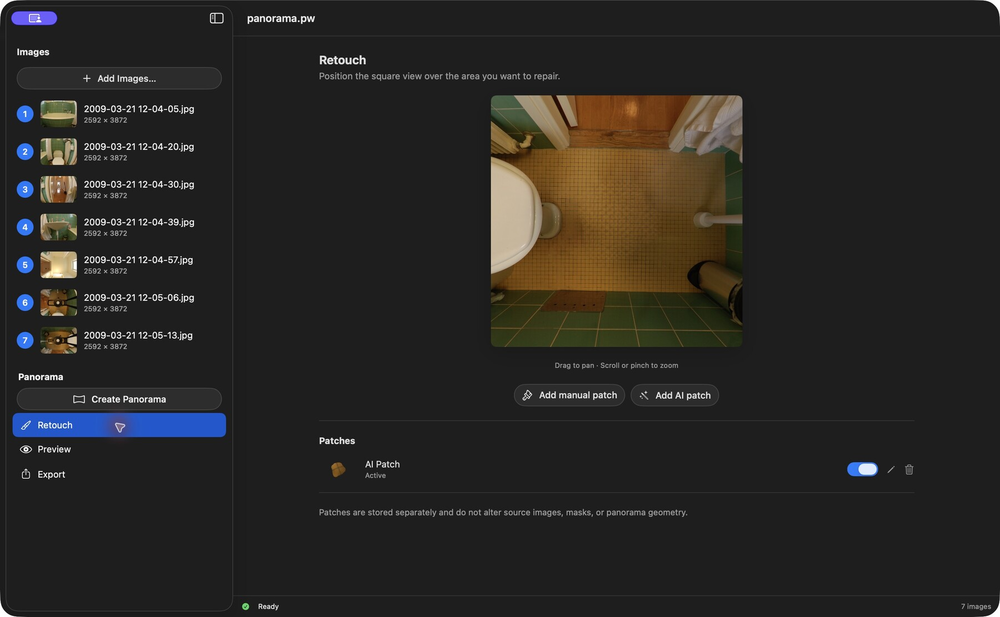
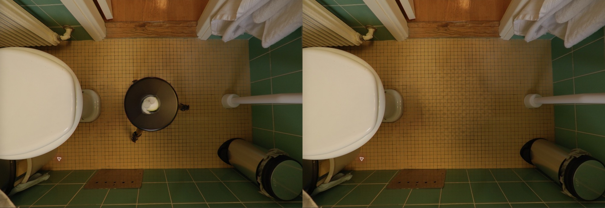
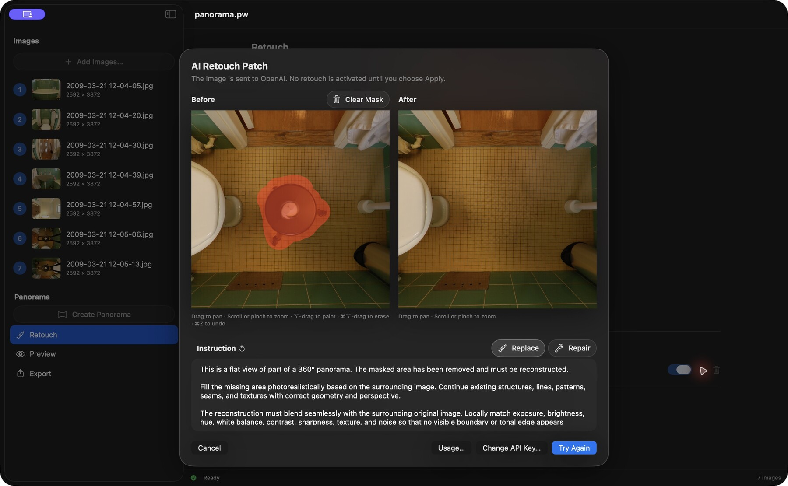

# Create an AI patch

An AI patch changes a small area of an otherwise finished panorama. The captured image, mask, and active instruction are sent to OpenAI. The result stays a preview until you choose **Apply**.

## Explore the saved repair in example C

[Download and open example C](../../examples.html#example-c). It has seven source JPEGs and one saved AI patch repairing the mosaic floor below the camera.

1. Open **Retouch** and find **AI Patch** in **Patches**.
2. Click its thumbnail to locate the floor in Preview.
3. Return to Retouch and switch the patch off, then click the thumbnail again to inspect the same area without the repair. Repeat with the switch on.

*Left: the camera support is visible. Right: the saved AI result continues the mosaic floor. The source images are unchanged.*

Viewing and toggling the saved patch requires no API key and makes no generation request. To inspect its saved mask and instruction, click its pencil button; choose **Cancel** to leave it unchanged. Do not choose **Try Again** unless you intend to generate a new result.

## Complete a missing nadir and zenith: example G

[Example G — Autumn garden](../../examples.html#example-g) contains six Nikon NEF RAW photographs from a horizontal ring, with no separate photograph looking straight down (**nadir**) or straight up (**zenith**). Both areas are completed by saved AI patches in **Replace** mode: grass and fallen leaves below the camera, and branches and leaves above it.

This demonstrates how AI retouching can reconstruct missing coverage at both poles, as well as remove unwanted objects. Open **Retouch** and click each patch thumbnail to locate its view in **Preview**. Return to Retouch to switch that patch off, then click its thumbnail again to compare the same view. Repeat with the switch on. The first patch repairs the nadir; the second repairs the zenith. No API key is needed to explore the saved results. The [example guide](../../examples.html#example-g) shows both patches.

The saved instructions add a short scene description to the default Replace text: grass and leaves for the nadir, and branches and leaves for the zenith. To try a similar repair, use **Replace** and describe what should continue into the missing area. Inspect the saved masks and instructions with the pencil button; choose **Cancel** to keep the example unchanged.

## Before generating a new repair

AI retouch requires internet access and your own OpenAI API key. API usage is billed separately by OpenAI; it is not included in a ChatGPT or Codex subscription.

Use **Create API Key…** in the patch dialog to open setup, then **Open OpenAI API Keys…** to obtain a key, or paste one you already have. **Change API Key…** replaces it. **Usage…** opens the usage dashboard. For data handling, see [Privacy Policy](../../privacy.html).

## Choose the area

Open **Retouch**, frame the problem in the square view, and click **Add AI patch**. Drag to pan; scroll or pinch to zoom without a modifier.

Use a copy of the entire C folder when practicing, so the finished example stays available.

The dialog contains a fixed capture. Its pan/zoom controls inspect that image; cancel and reposition in Retouch to capture a different area.

## Mask and generate

In **Before**, **Option-drag** over the problem. **Command-Option-drag** erases; **Command-Z** undoes a stroke. **Clear Mask** removes the mask. Transparent gaps are selected automatically in a new patch.

Choose **Replace** to generate content for the masked area, or **Repair** to fix it while preserving as much of its visible original content as possible. New patches start in **Replace** mode. Each mode has its own editable instruction. Switching modes keeps both texts; the reset button restores the default instruction for the selected mode. Only the active instruction is sent to OpenAI.

For example, use **Replace** when something is missing: “Fill the masked area with the same wooden floor pattern as the surrounding boards.” Use **Repair** when the original is visible but needs correction: “Remove the dark stain from the floor. Keep the existing board pattern and preserve the rest of the image.”

When editing an existing patch, its selected mode and both instructions are restored. Choosing **Apply** saves the selected mode and both instruction texts with that patch, so you can return to either mode later without losing edits.

Click **AI Retouch** to generate a preview. A mask and a nonempty active instruction are required; generation may take a while and can be cancelled.

## Write a useful instruction

Use the mask to identify **where** to edit and the instruction to explain **what should appear there**. “Remove artifacts” is often too vague: name the unwanted object or defect, such as a tripod, a doubled edge, or a broken paving pattern.

A useful instruction covers three things:

- **What to remove or correct:** the tripod, camera support, seam, or distorted detail inside the mask.
- **What should replace it:** the surrounding paving, floorboards, grass, sky, or another specific surface.
- **What to preserve:** the direction of lines, repeating patterns, perspective, texture, lighting, and color.

For example: “Replace the camera support inside the mask with wooden flooring. Continue the existing boards and their seams in the same direction and perspective. Match the grain, lighting, and color, and preserve the unmasked surroundings.”

[Example D](../../examples.html#example-d) shows why specific details help: the replacement paving needs to continue the curved boundaries between dark and light stones. Its guide includes a prompt you can adapt. You can keep the default instruction and add this kind of scene-specific guidance to it.

Inspect the result for the details you requested. If a curve or seam is wrong, describe that specific correction before choosing **Try Again**, rather than only asking for a “better” result. Each new attempt generates a new result and incurs API usage.

## Review and apply

Inspect lines, textures, color, and the repair boundary in **After**. AI can invent plausible but incorrect details. Choose **Try Again** for another attempt, or **Apply** to keep the result.

*The red mask selects the camera support in Before; After contains the saved generated floor repair. An AI repair is generated content, not recovered source pixels.*

[Example A](../../examples.html#example-a) also includes a saved AI repair of the cobblestone ground below the camera, alongside its manual pole repair. Click the **AI Patch** thumbnail in A to locate it, then compare with the patch switched off and on.

[Example B](../../examples.html#example-b) includes a more ambitious AI reconstruction of the Eiffel Tower from above, alongside a manual patch. Inspect it as generated content, not as evidence of the tower's exact appearance.

In **Patches**, use the switch to hide/show a repair, click its thumbnail to locate it, or use the pencil/trash button to edit/delete it. Finish source corrections first: changing sources or masks clears patches. Save the project to keep an accepted repair.

[Back to PanoWizard Help](../../index.html)
