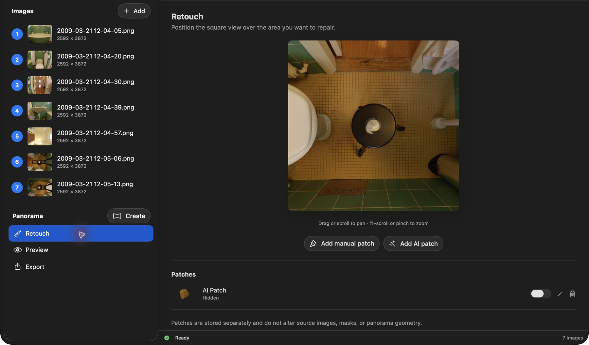
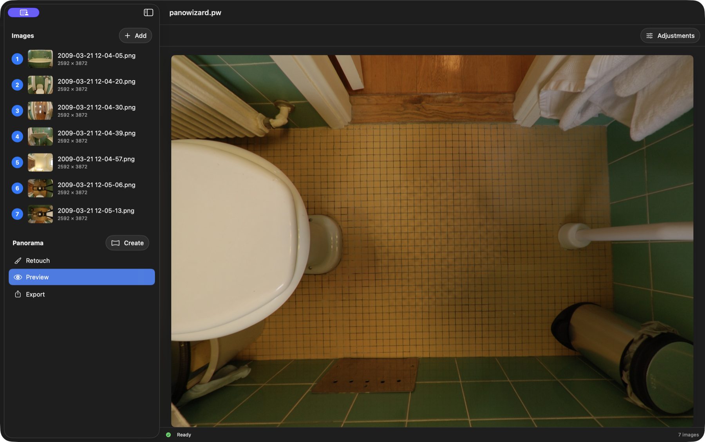

# Create an AI patch

An AI patch changes a small area of an otherwise finished panorama. The captured image, mask, and active instruction are sent to OpenAI. The result stays a preview until you choose **Apply**.

## Before you start

AI retouch requires internet access and your own OpenAI API key. API usage is billed separately by OpenAI; it is not included in a ChatGPT or Codex subscription.

Use **Create API Key…** in the patch dialog to open setup, then **Open OpenAI API Keys…** to obtain a key, or paste one you already have. **Change API Key…** replaces it. **Usage…** opens the usage dashboard. For data handling, see [Privacy Policy](../../privacy.html).

## Choose the area

Open **Retouch**, frame the problem in the square view, and click **Add AI patch**. Drag to pan; scroll or pinch to zoom without a modifier.

The dialog contains a fixed capture. Its pan/zoom controls inspect that image; cancel and reposition in Retouch to capture a different area.

## Mask and generate

In **Before**, **Option-drag** over the problem. **Command-Option-drag** erases; **Command-Z** undoes a stroke. **Clear Mask** removes the mask. Transparent gaps are selected automatically in a new patch.

Choose **Replace** to generate content for the masked area, or **Repair** to fix it while preserving as much of its visible original content as possible. New patches start in **Replace** mode. Each mode has its own editable instruction. Switching modes keeps both texts; the reset button restores the default instruction for the selected mode. Only the active instruction is sent to OpenAI.

For example, use **Replace** when something is missing: “Fill the masked area with the same wooden floor pattern as the surrounding boards.” Use **Repair** when the original is visible but needs correction: “Remove the dark stain from the floor. Keep the existing board pattern and preserve the rest of the image.”

When editing an existing patch, its selected mode and both instructions are restored. Choosing **Apply** saves the selected mode and both instruction texts with that patch, so you can return to either mode later without losing edits.

Click **AI Retouch** to generate a preview. A mask and a nonempty active instruction are required; generation may take a while and can be cancelled.

## Review and apply

Inspect lines, textures, color, and the repair boundary in **After**. AI can invent plausible but incorrect details. Choose **Try Again** for another attempt, or **Apply** to keep the result.

*Left: original. Right: the saved repair enabled. An AI repair is generated content, not recovered source pixels.*

In **Patches**, use the switch to hide/show a repair, click its thumbnail to locate it, or use the pencil/trash button to edit/delete it. Finish source corrections first: changing sources or masks clears patches. Save the project to keep an accepted repair.

[Back to PanoWizard Help](../../index.html)
