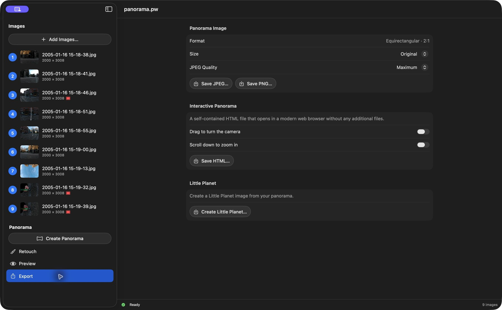

# Create a Little Planet

A Little Planet turns the full 360° panorama into a square stereographic projection.

## Open Little Planet

Open [example A](../../examples.html#example-a), or finish your own panorama. Open **Export**, and click **Create Little Planet…**.

## Shape the planet

The large preview shows the exported composition. All controls are visible:

- **Zoom** ranges from **0–100%**. Lower it to fit more of the surroundings
  inside the square image; raise it for a closer view.
- **Rotation** turns the result without moving its center.
- **Tilt** moves from **Planet** (0°, ground in the center), through sideways
  (90°), to **Tunnel** (180°, sky in the center).
- **Center** moves the center horizontally around the panorama
  (0–360°). Tilt chooses its height; Rotation turns the result around that center.
- Click the panorama thumbnail to set both Tilt and Center together.
  The marker follows both sliders. A point near the horizon tips the planet sideways.
- **Reset** restores the default planet, size and rotation.

The preview updates as you adjust a slider; releasing it refines the preview.
After a successful export, Little Planet remembers Zoom, Rotation, Tilt and
Center **for this project**. Save the project to keep that composition in its
`.pw` file; reopening or copying the project restores it. Other projects keep
their own settings. Cancel, Reset or a failed export does not replace the
project's last exported composition.

The Zoom slider changes composition, not image resolution. The PNG dimensions
are shown beside **Export…**.

## Export the image

Click **Export…** and save the PNG. The default filename is `little-planet.png`. The planet image side matches the panorama height: for example, a 4096 × 2048 panorama produces a **2048 × 2048** planet image. Full-resolution panoramas can produce larger planet images.

[Back to PanoWizard Help](../../index.html)
