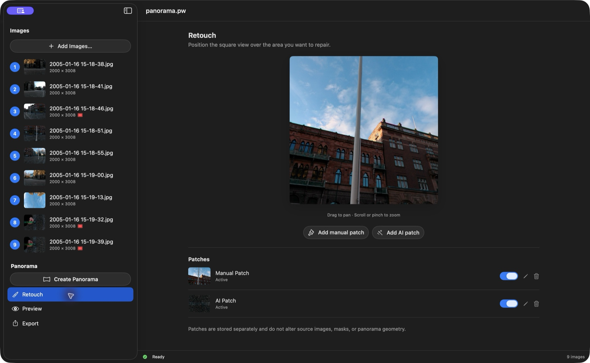
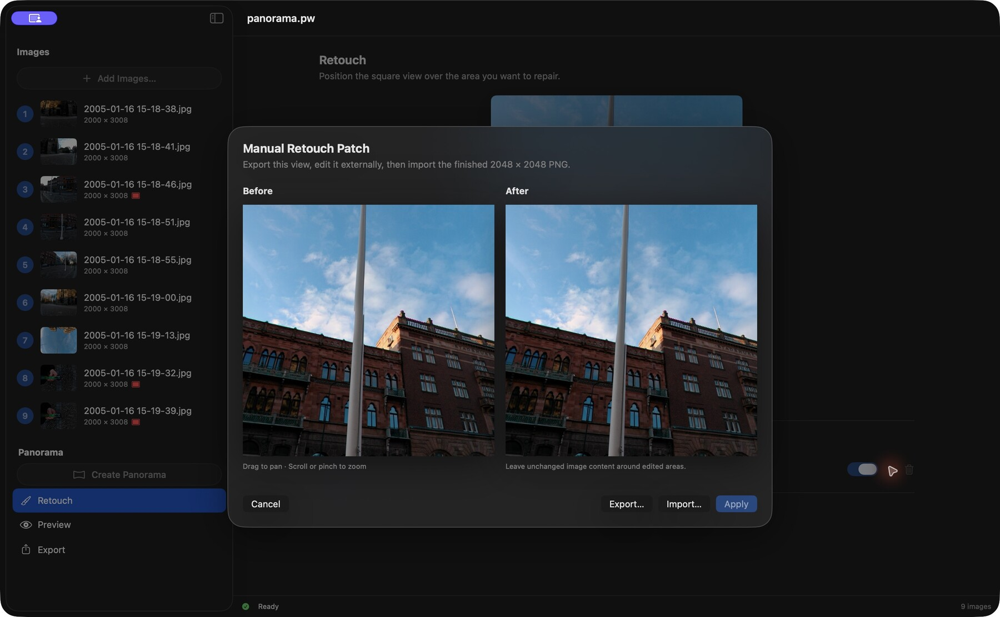

# Create a manual patch

A manual patch repairs a small area of an otherwise finished panorama using an external image editor. It does not alter the source photographs or panorama geometry.

## Explore the saved patch in example A

[Download and open example A](../../examples.html#example-a), then choose **Retouch**. The saved **Manual Patch** repairs a local area at the pole. Use its switch to hide or show it; click its thumbnail to locate that exact area in Preview. Return to Retouch to toggle it again. A also has an independent **AI Patch** on the ground below the camera; leave that enabled while comparing the manual repair.

*Left: patch disabled. Right: patch enabled. Source masks remain unchanged in both views.*

Duplicate the whole A folder before trying a repair yourself. The following steps create a new patch; simply viewing the saved example needs no external editor.

## Choose the area

Open **Retouch**, position the square view over the problem, and click **Add manual patch**. Drag to pan; scroll or pinch to zoom without a modifier.

This captures a fixed view. Inside the patch dialog, pan and zoom inspect that capture; to choose a different panorama area, cancel and reposition in Retouch.

## Export and edit

Click **Export…** to save a **2048 × 2048 PNG**. Open it in your image editor and repair the problem. **Do not resize or crop it.** Leave unchanged image content around the repair for blending.

## Import and apply

Return to PanoWizard, click **Import…**, and select the edited PNG. Compare **Before** and **After**, then click **Apply**.

The patch appears in **Patches**. Click its thumbnail to locate it in Preview, use the switch to hide/show it, or choose its pencil/trash button to edit/delete it. Newer patches appear over older ones where they overlap.

Example B also contains a saved manual patch, alongside an AI patch. See [the examples](../../examples.html#example-b).

Finish source corrections first: changing sources or masks clears retouch patches. Save the project to keep the repair.

[Back to PanoWizard Help](../../index.html)
