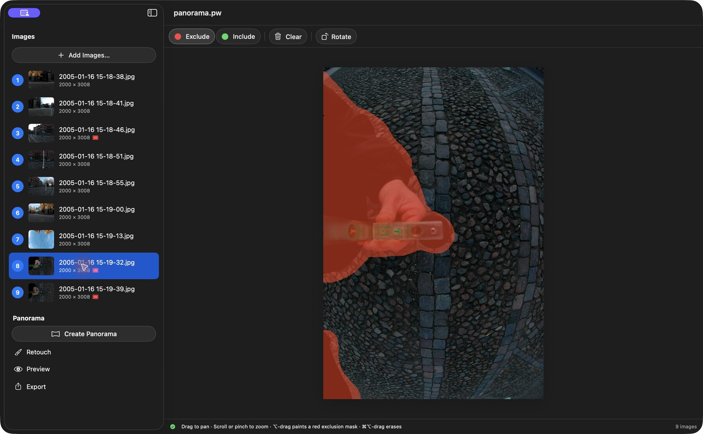
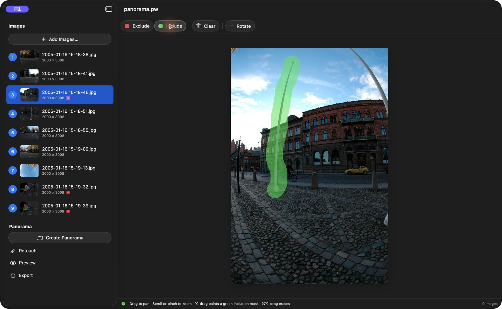
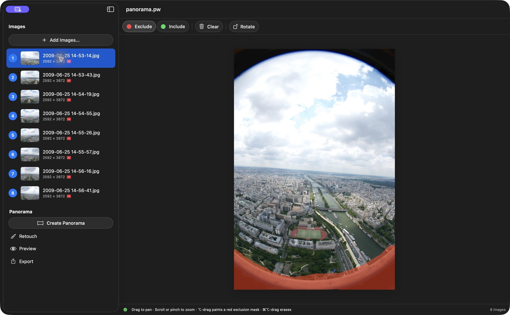

# Mask source images

A source mask guides which real photograph supplies overlapping pixels. Use [example A](../../examples.html#example-a) to inspect both red and green masks. Its nine source photographs and saved project are included in the download.

## Inspect the red masks

Open **A/panorama.pw**. Select `2005-01-16 15-19-32.jpg` in the sidebar, then choose **Exclude**. A red mask covers the hand and level. The next photograph, `2005-01-16 15-19-39.jpg`, has another red mask.

**Red / Exclude:** do not use these source pixels.

## Inspect the green mask

Select `2005-01-16 15-18-46.jpg` and choose **Include**. The green mask follows one intact pole, preferring it over competing overlap.

**Green / Include:** prefer these existing pixels when choosing overlapping content. It does not create missing content.

Selecting an image or switching Exclude/Include lets you inspect masks without repainting them.

## Paint your own masks

**Duplicate the entire A folder before changing masks. Changing masks clears the panorama, patches, and adjustments. A successful new Create also clears patches and resets adjustments.** Finish masks before retouching.

- Choose **Exclude** or **Include**, then **Option-drag** to paint that mask.
- Drag without Option to pan. Scroll or pinch to zoom.
- **Command-Option-drag** erases the selected mask type.
- **Edit → Undo Mask Change** (Command-Z) undoes the last source-mask change for the selected image.
- **Clear** removes the selected image's current mask type: Exclude or Include.

Keep masks small. Exclude unwanted content only where another source offers replacement coverage. If holes remain, reduce exclusion or supply a suitable source photograph.

## Rebuild and inspect

In your practice copy, click **Create Panorama** again. Inspect the ground and pole in **Preview**. Mask changes affect the newly stitched result; they do not repaint the saved panorama directly.

*The downloadable finished A project includes source masks, a manual patch at the pole, and an AI patch on the ground. Rebuilding applies the masks but removes both retouch patches; the two results need not look identical.*

For more masks, inspect [example B](../../examples.html#example-b): each of its eight source images has an Exclude mask.

Next: [Create a manual patch](../ManualPatch/index.html).

[Back to PanoWizard Help](../../index.html)
