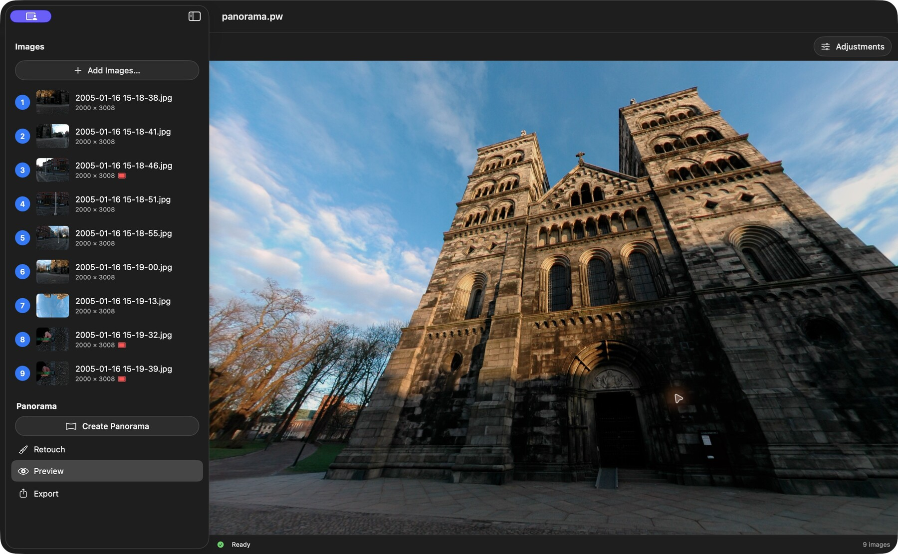
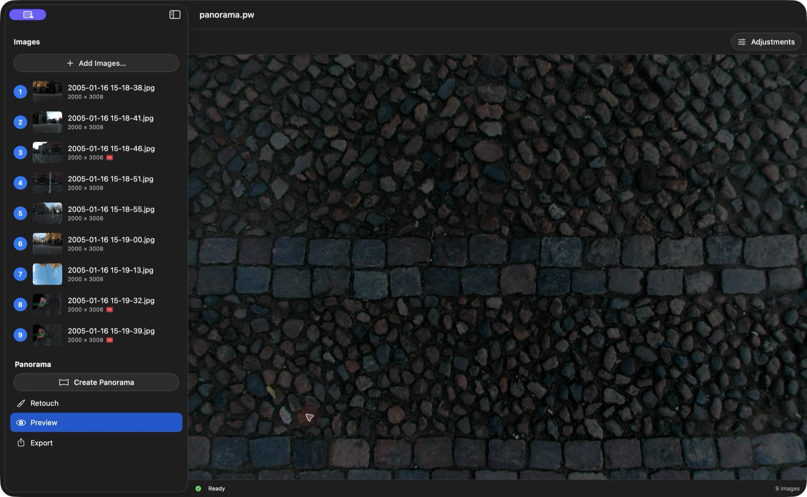
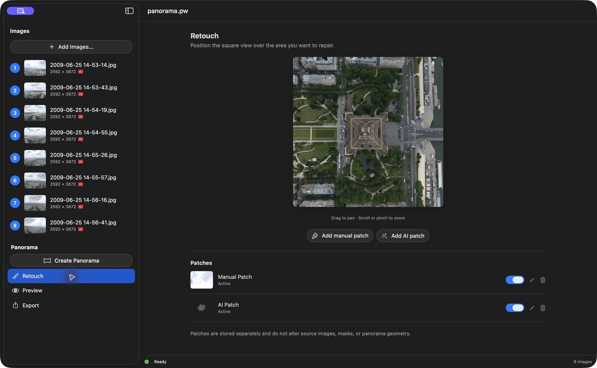
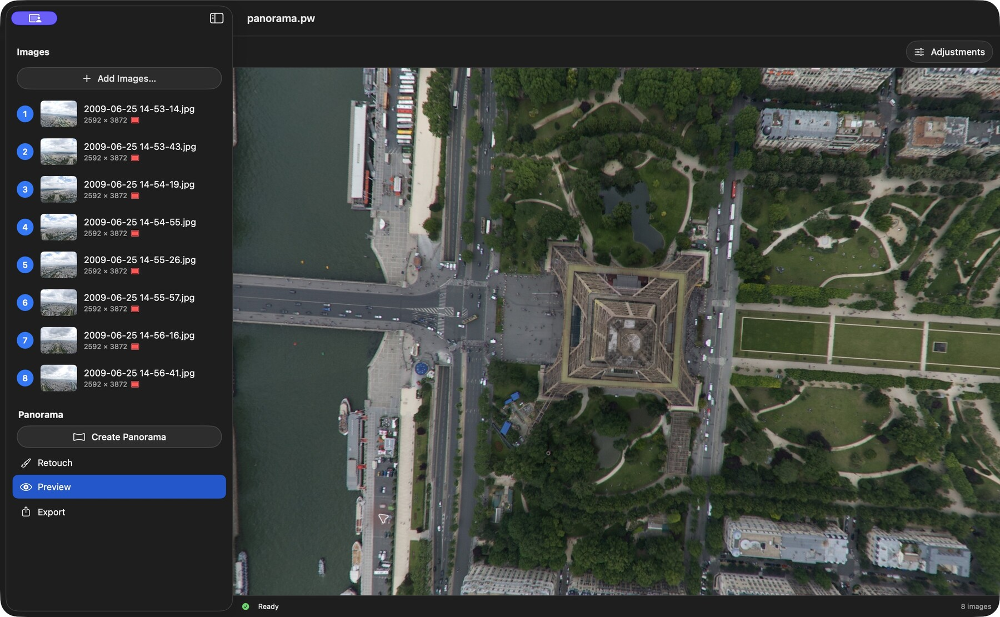
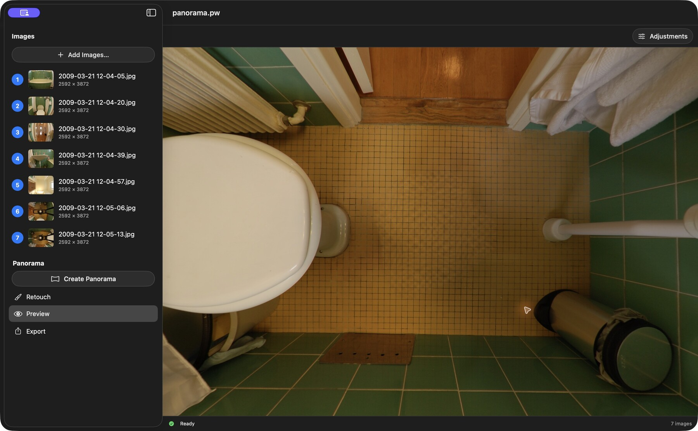
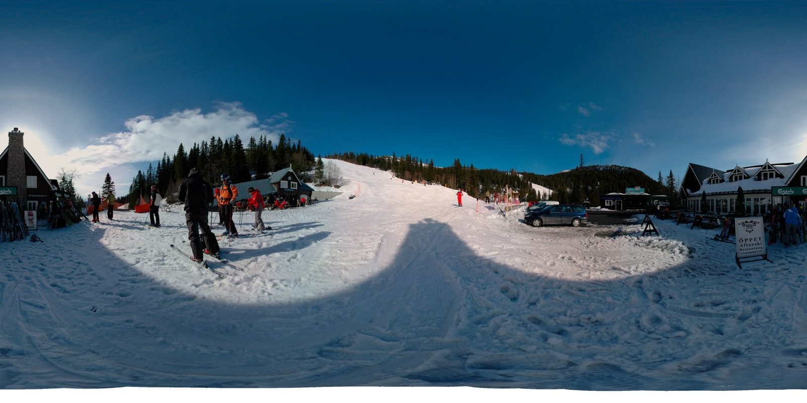
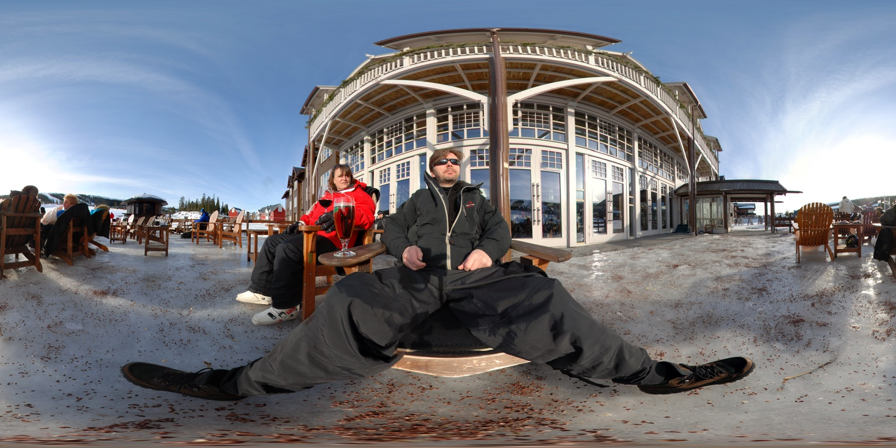

# Explore the example panoramas

Start with a finished panorama, then inspect how its source photographs, masks, and retouch patches work together. These are the same downloadable projects used throughout this help, and are suitable for App Store Review.

## Download and open

1. Choose **Help → Download Examples…** in PanoWizard, or download [examples.zip](https://github.com/meg768/panowizard/releases/download/examples/examples.zip). No development tools are required.
2. Double-click **examples.zip** in Finder and open the extracted **examples** folder.
3. Launch PanoWizard. Choose **File → Open…**, then select **panorama.pw** inside A, B, C, D, E, or F.
4. If prompted, select that same A, B, C, D, E, or F folder and click **Grant Access**. This lets macOS read the source photographs.
5. Choose **Panorama → Preview**. Drag to look around; scroll or pinch to zoom.

Keep each entire example folder together: the source photographs belong beside `panorama.pw`, not inside it. Moving the whole folder preserves the relative source references. Check the sidebar against the image counts below. See [File Access](file-access.html) if photographs are unavailable.

The saved panoramas and patches are ready to explore. No API key is needed to view or toggle existing AI patches. Only generating new AI results requires your own OpenAI API key and separately billed API usage.

**Before experimenting, duplicate the entire A, B, C, D, E, or F folder in Finder and open the copy.** Changing sources or source masks clears the panorama, patches, and adjustments; rebuilding also clears patches and resets adjustments.

## A — Church square

**9 JPEG photographs · 2 Exclude masks · 1 Include mask · 1 manual patch · 1 AI patch**

Start here for [source masks](HowTo/Masking/index.html): select `2005-01-16 15-19-32.jpg` or `15-19-39.jpg` and choose **Exclude** to inspect the red masks over the hand and level. Select `2005-01-16 15-18-46.jpg` and choose **Include** to see the green mask preferring an intact pole.

Open **Retouch** to find the saved **Manual Patch**. Its thumbnail locates the repaired pole in Preview. Follow the [manual patch guide](HowTo/ManualPatch/index.html) to compare it with the unpatched view.

A also contains an **AI Patch** repairing the cobblestone ground directly below the camera. Click its thumbnail to look down at the repair, then toggle it off and on to compare. Both saved patches can be inspected without an API key. See the [AI patch guide](HowTo/AIPatch/index.html) before generating a new result.

*The cobblestone repair is generated content, not recovered source pixels.*

## B — Paris from above

**8 JPEG photographs · Exclude masks on all 8 sources · 1 manual patch · 1 AI patch**

Select the source photographs to inspect their red masks. In **Retouch**, the two patches can be toggled independently. Click each thumbnail to locate its area in Preview: the manual patch is at the sky and the AI patch is at the ground below the camera.

The downward AI patch reconstructs the Eiffel Tower from above. This is generated content, not a recovered photograph or a guarantee of architectural accuracy. B is useful for exploring several corrections in one project; C provides a simpler AI repair exercise.

## C — Bathroom floor

**7 JPEG photographs · no source masks · 1 AI patch**

Open **Retouch**, then click the **AI Patch** thumbnail to look down at the mosaic floor. Toggle that patch off and on to compare the camera support with the saved repair. See the [AI patch guide](HowTo/AIPatch/index.html) for the mask and matching before/after images.

## D — City square and fountain

**11 JPEG photographs · 9 Exclude masks · no Include masks · 1 AI patch**

Explore the square, fountain, and patterned paving in **Preview**. Select the source photographs and choose **Exclude** to inspect the nine saved red masks.

Open **Retouch** and click the saved **AI Patch** thumbnail to locate its area in Preview. Toggle the patch off and on to compare. The saved patch is enabled and can be explored without an API key; generating a new result requires your own API key and separately billed usage. AI retouching is generated content, not recovered source pixels.

## E — Ski slope

**9 JPEG photographs · 2 Exclude masks · 1 Include mask · 1 manual patch · no AI patches**

Explore the ski slope and surrounding buildings in **Preview**. Select `2005-04-06 14-57-30.jpg` or `2005-04-06 14-57-37.jpg` and choose **Exclude** to inspect the red source masks. Select `2005-04-06 14-58-13.jpg` and choose **Include** to inspect the green source mask. See the [Masks guide](HowTo/Masking/index.html) for how these masks guide overlapping image selection.

Open **Retouch** and click the **Manual Patch** thumbnail to locate its area in Preview. Toggle the patch off and on to compare the saved repair. E provides another example of [manual retouching](HowTo/ManualPatch/index.html), without AI-generated patches.

## F — Snowy outdoor terrace

**6 Nikon NEF RAW photographs · no Exclude masks · 1 Include mask · no retouch patches**

Explore the terrace, seated people, and surrounding buildings in **Preview**. F uses Nikon D80 NEF RAW source photographs, unlike the JPEG sources in A–E. Keep all six `.NEF` files beside `panorama.pw`.

**No AI was used in F.** The tripod is hidden using only a green **Include** mask, which favors existing pixels from an overlapping source photograph. There are no manual or AI retouch patches.

Select `2008-02-23 14-47-40.NEF` and choose **Include** to inspect that saved green source mask. See the [Masks guide](HowTo/Masking/index.html) for how Include masks influence seam selection.

## Try the next step

- [Getting Started](getting-started.html): open a result or create a panorama from sources.
- [Preview and Adjustments](preview.html): explore the sphere and change its overall appearance.
- [Little Planet](HowTo/LittlePlanet/index.html): turn A into a square planet image.
- [Export](export.html): save an image or an interactive HTML viewer.

[Back to PanoWizard Help](index.html)
