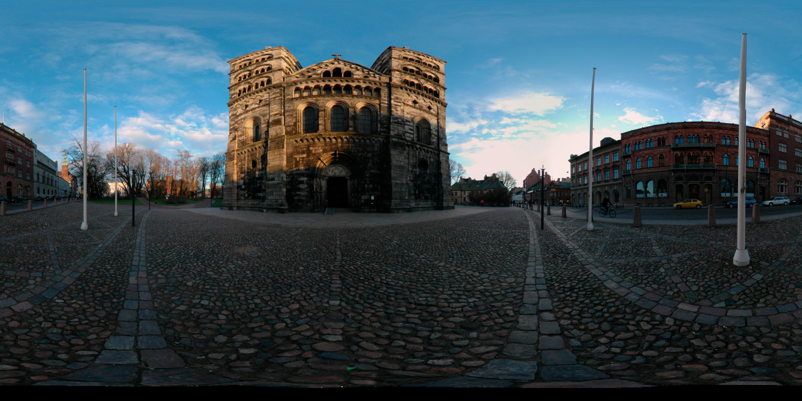

# Export

Open **Export** and choose:

- **Save JPEG…** for a compact panorama image.
- **Save PNG…** for a lossless panorama image.
- **Save HTML…** for a self-contained interactive 360° viewer.

## Image size and quality

JPEG and PNG use the **2:1 equirectangular** format: the whole sphere laid out as a rectangle. It looks stretched in an ordinary image viewer.

**Size: Original** preserves the full-resolution panorama created and stored in your project. Export applies your patches and adjustments without stitching again. **4096 px** and **2048 px** produce smaller image exports. **JPEG Quality** affects JPEG only.

Older projects keep their existing panorama dimensions. To obtain more detail from their source images, create the panorama again. A new Create clears existing patches and resets adjustments, so preserve a copy of a finished project before doing so.

## Interactive viewer

HTML embeds a JPEG image. Choose **Size** in the Interactive Panorama section:

| Size | Maximum width |
| --- | --- |
| Small | 4096 px |
| Medium (default) | 8192 px |
| Large | 12288 px |
| Original | Saved panorama width |

Smaller panoramas are not enlarged. **JPEG Quality** offers **Normal** (82%, default), **High** (92%), and **Maximum** (98%). Higher quality produces larger files. The HTML size and quality choices are independent of the Panorama Image settings; the full-resolution panorama in your project is preserved.

Before **Save HTML…**, use **Drag to turn the camera** to make dragging turn the viewing direction, or **Scroll down to zoom in** to choose downward scrolling for zooming in. Pinch zoom keeps its normal direction. Both switches are off by default. Both choices are saved globally for future exports, not in the project. The exported viewer uses your chosen directions.

The HTML file includes the panorama and opens in a browser with WebGL 2 support, without extra image files. It starts at the direction and zoom chosen in Preview. Drag to look around and scroll or pinch to zoom. Saving HTML does not publish it online. The viewer divides the exported image into texture tiles for display, preserving the selected resolution even when the whole image is wider than a single GPU texture. Large panoramas also produce larger HTML files and use more browser memory.

Enabled patches and global adjustments are included in exports. Save the `.pw` project separately if you want to continue editing.

For a square planet image, see [Little Planet](HowTo/LittlePlanet/index.html).

[Back to PanoWizard Help](index.html)
