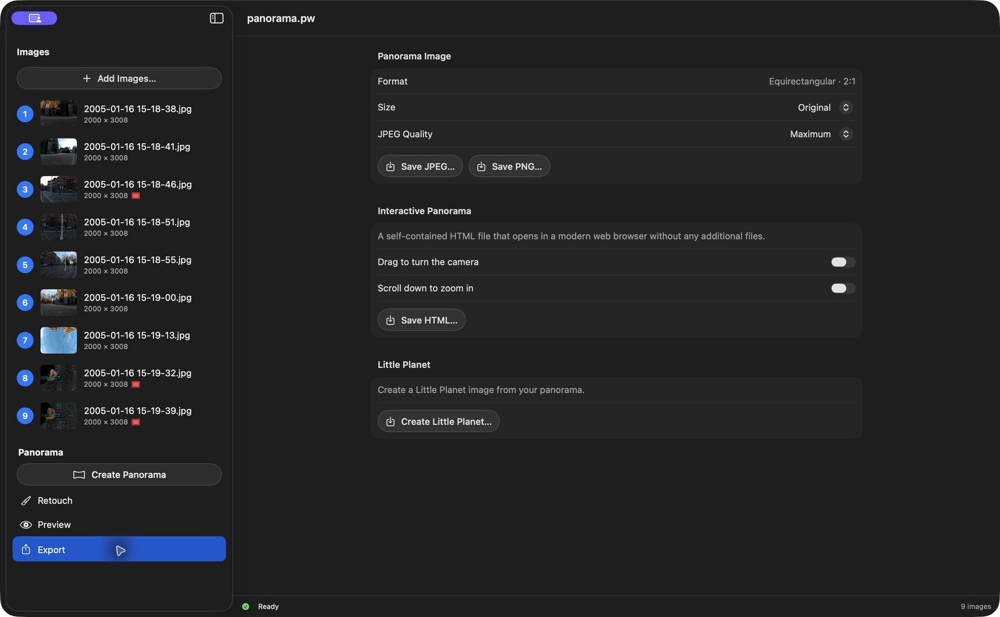
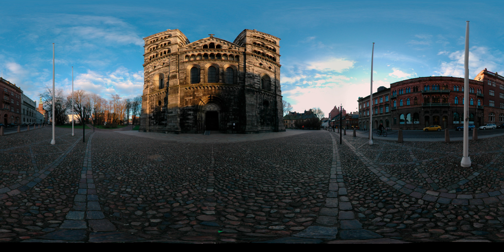

# Export

Open **Export** and choose:

- **Save JPEG…** for a compact panorama image.
- **Save PNG…** for a lossless panorama image.
- **Save…** for a self-contained interactive 360° viewer.

## Image size and quality

JPEG and PNG use the **2:1 equirectangular** format: the whole sphere laid out as a rectangle. It looks stretched in an ordinary image viewer.

**Size: Original** preserves the full-resolution panorama created and stored in your project. Export applies your patches and adjustments without stitching again. **4096 px** and **2048 px** produce smaller image exports. **JPEG Quality** affects JPEG only.

Older projects keep their existing panorama dimensions. To obtain more detail from their source images, create the panorama again. A new Create clears existing patches and resets adjustments, so preserve a copy of a finished project before doing so.

## Interactive viewer

HTML embeds a JPEG image. Choose **Size** in the Interactive Panorama section:

| Size | Maximum width |
| --- | --- |
| Small | 4096 px |
| Medium | 8192 px |
| Large | 12288 px |
| Original (default) | Saved panorama width |

Smaller panoramas are not enlarged. The app remembers the Interactive Panorama size for future exports and publishing, across projects and app restarts. **JPEG Quality** offers **Normal** (82%, default), **High** (92%), and **Maximum** (98%). Higher quality produces larger files. The HTML size and quality choices are independent of the Panorama Image settings; the full-resolution panorama in your project is preserved.

Before **Save…**, use **Drag to turn the camera** to make dragging turn the viewing direction, or **Scroll down to zoom in** to choose downward scrolling for zooming in. Pinch zoom keeps its normal direction. Both switches are off by default. Both choices are saved globally for future exports, not in the project. The exported viewer uses your chosen directions.

The HTML file includes the panorama and opens in a browser with WebGL 2 support, without extra image files. It starts at the direction and zoom chosen in Preview. Drag to look around and scroll or pinch to zoom. Saving HTML does not publish it online. The viewer divides the exported image into texture tiles for display, preserving the selected resolution even when the whole image is wider than a single GPU texture. Large panoramas also produce larger HTML files and use more browser memory.

Enabled patches and global adjustments are included in exports. Save the `.pw` project separately if you want to continue editing.

## Publish to your own server

Choose **Publish…** beside **Save…** to upload the same interactive viewer using SFTP. Enter the hostname, port (normally 22), username, password, existing **Remote Directory**, and optional **Public Base URL**. Hostname also accepts a pasted HTTP or HTTPS address. These fields are always visible and are remembered automatically when you click **Publish**; there is no separate save step. **Close** discards edits made since the last Publish. One connection is saved locally, including the password, without Keychain encryption.

**Path (Optional)** adds subfolders inside Remote Directory. For example, `2019/Toscana` uploads to `Remote Directory/2019/Toscana/filename.html`. Missing folders are created automatically, including several levels such as `A/B/C/D`. Existing folders are reused. Leave Path empty to upload directly into Remote Directory. Absolute paths and `.` or `..` components are rejected; paths resolving outside Remote Directory are also rejected. The account needs permission to create folders and write files.

The **Filename** defaults to the project name and stays separate from Path. Filename and Path are stored in the project when you click Publish. Save the `.pw` project normally to keep them with the project, including when copying it to another Mac. Previously remembered local values are transferred into the project when you first open the Publish dialog. Verify the server's SSH public key on the first connection before trusting it. A changed key stops publishing. If the destination file exists, PanoWizard asks before replacing it. Keep the dialog open until **Uploaded successfully.** appears. If Public Base URL is empty, the success message is **Uploaded successfully.** If provided, the message also includes a clickable link to the uploaded panorama. **Public Base URL** is the website folder corresponding to Remote Directory. The final link appends Path and Filename with URL-encoded components, including spaces and Swedish characters; clicking it opens your default browser.

The HTML size, quality, navigation, patches and adjustments follow the existing export settings. **Save…** continues to save a local file.

Publishing always creates and uploads both the interactive HTML and a matching JPEG thumbnail. Publish renders the exported interactive viewer at its saved initial camera and field of view into a 640 × 360 perspective JPEG (quality 80). The JPEG uses the HTML basename and is uploaded to the same directory. A companion JPG is used automatically by Panorama Browser after refresh. There is no thumbnail setting. Local HTML, JPEG and PNG saving are unchanged.

Existing JPEGs require confirmation before replacement. JPEG data is uploaded under a temporary hidden name and renamed only after the transfer completes; an existing JPEG is preserved during replacement and restored if final publication fails. **Uploaded successfully.** appears only after both files have been published. If HTML succeeds but JPEG publishing fails or is cancelled, the dialog explicitly reports that HTML was published but thumbnail publishing did not complete. Rendering uses built-in macOS WebKit and the actual exported HTML, including adjustments, with no additional dependencies or server renderer.

For a square planet image, see [Little Planet](HowTo/LittlePlanet/index.html).

[Back to PanoWizard Help](index.html)
