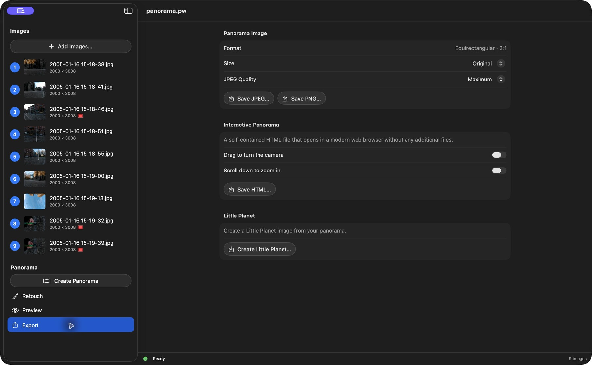
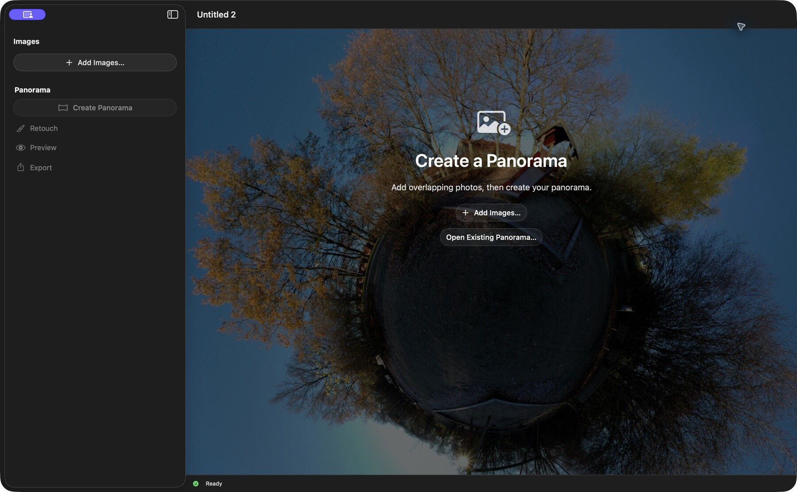

# Get started with PanoWizard

**Open → Explore → Export**, or **Import → Create → Preview → Export** when starting from source photographs.

## 1. Open a finished example

[Download the five example panoramas](examples.html), then open **A/panorama.pw** with **File → Open…**. If asked for access, choose the A folder and click **Grant Access**. The sidebar should show nine source photographs.

You do not need to stitch again to explore the saved result. Keep the source JPEGs beside the project, and duplicate the whole A folder before making changes.

## 2. Explore the panorama

Choose **Panorama → Preview**. Drag to look around; scroll or pinch to zoom. Look up at the sky, down at the ground, and around the full circle. **View → Reset View** resets the view.

The [Masks guide](HowTo/Masking/index.html) explains A's red and green source masks. Open **Retouch** to inspect its saved manual patch at the pole and AI patch on the cobblestone ground below the camera. Click a patch thumbnail to locate it in Preview, and use its switch to compare before and after. No API key is needed to explore either saved patch. For another AI floor repair, open [example C](examples.html#example-c).

## 3. Export

Select **Export**, then **Save JPEG…** for an image or **Save HTML…** for an interactive panorama you can open in a browser. **Size: Original** keeps the saved panorama's dimensions.

Save the editable project with **File → Save** (Command-S) to keep your changes. Exporting an image does not save the project.

## Create a panorama from the photographs

Choose **File → New** for an empty project.

1. Click **Add Images…** and select all nine JPEGs in a copy of the A folder. Do not select `panorama.pw`.
2. Click **Create Panorama** under **Panorama** in the sidebar, or choose **Panorama → Create**.
3. Wait while the images are aligned and stitched. **Preview** opens when creation finishes.
4. Save your new project beside the photographs using a different name, such as `practice.pw`.

A new project does not inherit the saved example's masks or patches. Its first result can therefore differ from the finished example. Use the [mask exercise](HowTo/Masking/index.html) before adding retouch patches.

## Next steps

- [Adding Source Images](source-images.html)
- [Creating the Panorama](creating-panorama.html)
- [Preview and Adjustments](preview.html)
- [Manual Retouch](HowTo/ManualPatch/index.html)
- [AI Retouch](HowTo/AIPatch/index.html)
- [Little Planet](HowTo/LittlePlanet/index.html)

[Back to PanoWizard Help](index.html)
