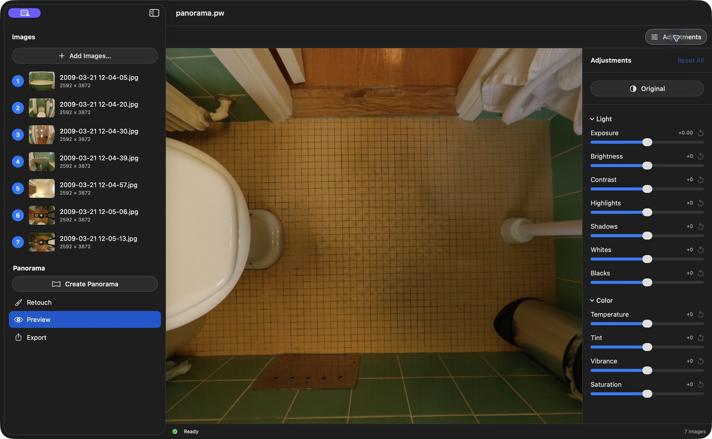

# Preview and Navigation

Drag to look around. Scroll or pinch to zoom without a modifier. **View → Zoom In**, **Zoom Out**, and **Reset View** are also available (Command-Plus, Command-Minus, Command-0).

Preview uses a display image up to 4096 pixels wide. The full-resolution panorama remains stored in your project and is used for Original exports.

Use the sidebar button in the toolbar to hide or show the sidebar. Zoom commands are available when the current workspace has an image to navigate.

Look all the way around, then up at the sky or ceiling (**zenith**) and down at the ground (**nadir**). Check seams, straight lines, moving subjects, and missing coverage. A stretched flat export is normal; Preview shows the image as a sphere.

## Choose the right correction

| What needs fixing? | Use |
| --- | --- |
| A seam uses unwanted content and another source has clean pixels | [Source masks](HowTo/Masking/index.html), then Create again |
| A small blemish in an otherwise good panorama | [Manual](HowTo/ManualPatch/index.html) or [AI](HowTo/AIPatch/index.html) retouch |
| Overall brightness or color | **Adjustments** |

## Adjustments

Click **Adjustments** in Preview. Use **Light** for exposure and tone, and **Color** for white balance and saturation. **Original** temporarily shows the panorama without these adjustments; it does not remove patches. Use a slider's reset arrow or **Reset All** to undo adjustments.

The panel above shows [example C](examples.html#example-c) with its saved neutral adjustment values. Try sliders on a copy of the example; **Original** lets you compare your changes without disabling the AI patch.

Adjustments are saved with the project and included in exports. They do not repair alignment or seams.

[Back to PanoWizard Help](index.html)
